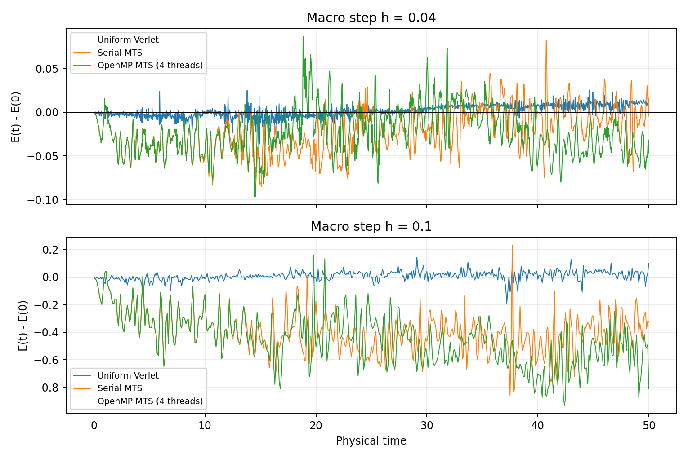

# Tuckerman MTS and its energy error

This project implements the disparate-mass `G_xyx` algorithm from Section
IV.A, equations (4.2)–(4.6), of Tuckerman, Berne and Martyna,
[*Reversible multiple time scale molecular dynamics*](https://doi.org/10.1063/1.463137),
*Journal of Chemical Physics* **97**, 1990–2001 (1992).
[Author-hosted paper](https://www.columbia.edu/cu/chemistry/groups/berne/papers/jcp_97_1990_1992.pdf).
The examples test this implementation rather than reproduce the paper's
entire dataset.

## What happens in one macro step?

`h` is the configured `dt`. The code chooses
`Ratio = max(1, floor(sqrt(heavy_mass / light_mass)))` and a small step
`delta = h / Ratio`. The mass ratio is a heuristic for choosing substeps;
it does not guarantee stability at every `h`.

For masses 1 and 100, `Ratio = 10`:

| Stage | Serial/OpenMP MTS | Inactive group |
| --- | --- | --- |
| First light stage | Five light Verlet steps of `h/10` | Heavy positions and velocities fixed |
| Heavy stage | One heavy Verlet step of `h` | Light positions and velocities fixed |
| Second light stage | Five light Verlet steps of `h/10` | Heavy positions and velocities fixed |

This composition advances the coupled system by one physical step `h`.
The individual split-stage durations should not be added as physical time.
The uniform baseline, `MDNormal`, instead takes ten Verlet steps of `h/10`
for **every particle**, including the heavy particles.

Within a restricted Verlet step, only the active group is updated:

```text
Half-kick: v <- v + (duration/2) * force / mass
Drift:     position <- position + duration * v; wrap periodic positions
Recompute the active group's same-group and cross-group forces
Half-kick: v <- v + (duration/2) * new_force / mass
```

Opposite forces are calculated and cached on inactive particles, but their
velocities are not updated. This is intentional in the selected paper
scheme. The [serial MTS guide](../MDMultipleTimeSteps/docs/README.md#force-buffers)
explains the caches; the [OpenMP guide](../MDMultipleTimeStepsOpenMP/docs/README.md)
describes parallel accumulation.

For odd `Ratio`, each light half-sequence uses `floor(Ratio/2)` small steps
and one half-small-step. The order is mirrored around the heavy step.
This extension also handles `Ratio = 1` and keeps each light stage's total
duration equal to `h/2`.

## Why can MTS have a larger energy error?

In the controlled runs shown below, MTS has larger energy errors. At the
same macro step, the implementations do different amounts of integration work:

| Source of error | Uniform Verlet | Tuckerman MTS |
| --- | --- | --- |
| Heavy motion | Resolved with the small step `h/Ratio` | Resolved with the coarse step `h` |
| Coupled motion | Both groups move together in every small step | One group's positions stay frozen while the other moves |
| Integration work | More pair-force evaluations | Fewer heavy–heavy force evaluations |

For example, with `h = 0.1` and `Ratio = 10`, the heavy particles take steps
of **0.01 in the normal algorithm and 0.1 in MTS**. The frozen-group
composition adds a splitting error as well. The MTS approximation can
therefore have a larger energy error while remaining second order.

Second order describes how an error decreases as the step is reduced;
it does not require different methods to have equal error amplitudes.
An error proportional to `C * h²` can have a different coefficient `C`
for each method. There is no universal factor by which MTS must be worse.
In particular, the tenfold heavy-step difference does not establish a
hundredfold total energy error: the masses, interactions and trajectory
also affect the coefficients.



The [energy report](../validation/results/energy_order/README.md) compares
identical initial states, macro steps and physical durations. It shows both
the actual error `E(t) - E(0)` and how energy fluctuations decrease as the
step is reduced. The [speed report](../validation/results/performance/README.md)
measures the computational savings. These are comparisons at equal macro
step, not at a matched energy-error target.

## Order and conservation

The fixed-step light/heavy/light composition is reversible and second order
for smooth forces. If energy standard deviation scales quadratically with
the step, its variance scales with the fourth power. Neither quantity alone
establishes exact energy conservation or the absence of long-time drift.
The force discontinuity at the cutoff also limits smooth-force arguments.

The selected coordinate-group MTS scheme is not generally canonical
symplectic. This does not mean that it fails to reproduce Section IV.A.
Symmetry, second-order accuracy and symplecticity are separate properties;
see Hairer, Lubich and Wanner,
[*Geometric numerical integration illustrated by the Störmer–Verlet method*](https://archive-ouverte.unige.ch/unige:12277)
(2003), which discusses these properties separately.
The larger observed energy error should be assessed through the actual
step sizes and splitting, rather than attributed to symplecticity alone.

OpenMP uses the same MTS update. Different addition orders can cause
roundoff-scale force differences that grow along long trajectories.
Two individual maximum energy errors are not a systematic serial/parallel
accuracy ratio. The optional [parallel comparison](../validation/results/parallel_accuracy/README.md)
examines that effect separately.
