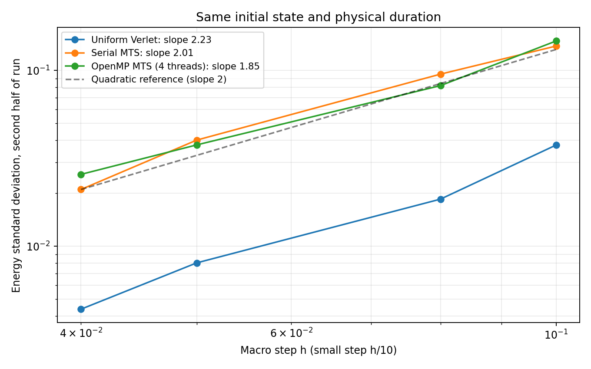

# Energy error and integration order

All implementations start from the same particle CSV and use the same
configuration, macro step and physical duration. The build is `releaseO3`.
Uniform Verlet updates every particle with `h/Ratio`; MTS updates the
heavy group with `h` and holds the other group fixed in each stage.

Duration: 50. Step sizes: `0.04`, `0.05`, `0.08`, `0.1`.

## Energy fluctuations

A slope near 2 means the standard deviation decreases approximately
quadratically with the step. Its variance then decreases with the fourth
power. The fit uses the second half of the run, excluding the final endpoint.

| Implementation | Standard-deviation slope | Variance slope |
| --- | ---: | ---: |
| Uniform Verlet | 2.227 | 4.453 |
| Serial MTS | 2.005 | 4.010 |
| OpenMP MTS (1 thread) | 2.005 | 4.010 |
| OpenMP MTS (4 threads) | 1.853 | 3.706 |



## Error relative to the initial energy


| Macro step | Implementation | Maximum abs(E - E0) | Final E - E0 |
| --- | --- | ---: | ---: |
| 0.04 | Uniform Verlet | 0.0361185 | +0.0023448 |
| 0.05 | Uniform Verlet | 0.0539888 | +0.00333319 |
| 0.08 | Uniform Verlet | 0.207233 | +0.00577266 |
| 0.1 | Uniform Verlet | 0.189941 | +0.100329 |
| 0.04 | Serial MTS | 0.0850431 | -0.00441813 |
| 0.05 | Serial MTS | 0.361813 | -0.283358 |
| 0.08 | Serial MTS | 0.529464 | -0.311493 |
| 0.1 | Serial MTS | 0.858771 | -0.327948 |
| 0.04 | OpenMP MTS (1 thread) | 0.0850431 | -0.00441813 |
| 0.05 | OpenMP MTS (1 thread) | 0.361813 | -0.283358 |
| 0.08 | OpenMP MTS (1 thread) | 0.529464 | -0.311493 |
| 0.1 | OpenMP MTS (1 thread) | 0.858771 | -0.327948 |
| 0.04 | OpenMP MTS (4 threads) | 0.0967506 | -0.031723 |
| 0.05 | OpenMP MTS (4 threads) | 0.207721 | -0.0625787 |
| 0.08 | OpenMP MTS (4 threads) | 0.529464 | -0.0339304 |
| 0.1 | OpenMP MTS (4 threads) | 0.932555 | -0.808743 |

Both methods can be second order with different error amplitudes.
The uniform baseline resolves heavy motion with a smaller step too.
MTS also introduces error by freezing the inactive group during a stage.
The relative error amplitudes depend on the state, mass ratio and step;
there is no universal MTS/uniform error factor.

One-thread OpenMP is the control for the serial MTS update. Multiple
threads can produce different long trajectories through force-summation
roundoff. Finite-run maxima are not a systematic parallel accuracy ratio.

These fits and trajectories do not prove a long-time energy bound.
The force is discontinuous at the cutoff, which limits smooth-force
convergence arguments. See [the algorithm guide](../../../docs/ALGORITHM.md).

## Reproduce

From the repository root:

```bash
python3 validation/check_energy_order.py
```

Use `--eigen-include /path/to/eigen` for a custom installation. Options
`--dt`, `--duration`, `--threads` and `--output-dir` select the experiment.
Raw jobs are temporary. [results.json](results.json) records the input
hash, configuration and fits; [energy_statistics.csv](energy_statistics.csv)
and [energy_traces.csv](energy_traces.csv) contain the numerical results.
