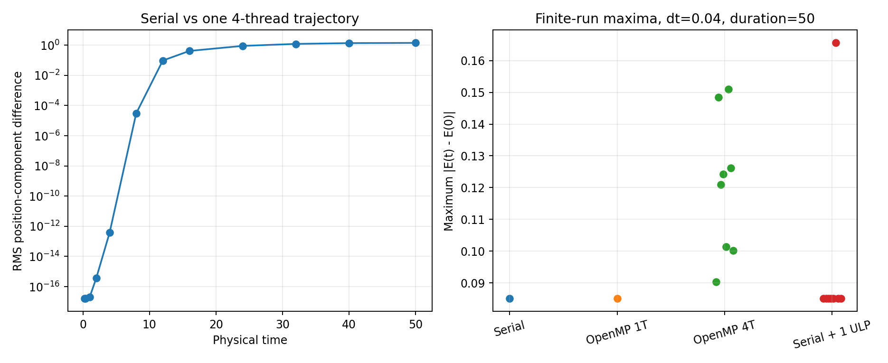

# Serial and OpenMP numerical agreement

This optional diagnostic checks whether energy differences between long
serial and OpenMP trajectories originate in force or energy bookkeeping.
It uses common 64-particle inputs, macro step 0.04 and physical duration 50.
The recorded run set contains one serial run, one one-thread OpenMP run,
eight four-thread repetitions and eight serial single-ULP input controls.

| Check | Recorded result |
| --- | --- |
| Serial versus one-thread OpenMP energy history | Bitwise identical for all 1250 steps |
| Largest force difference at 30 identical checkpoints | 2.84e-14 |
| Largest one-step position/velocity difference | 4.44e-16 |
| Largest discrepancy from an independent energy sum | 5.28e-13 |
| Four-thread maximum energy-error range over eight runs | 0.090371–0.150916 |

Changing a single serial initial velocity by one adjacent double-precision
value changed its maximum energy error from 0.085043 to 0.165567.
The changed value was particle 5's `vz`, from `-0.762379826364098` to
`-0.7623798263640981`. This is a sensitivity control, not a statistically
independent ensemble.



The observed force and one-step differences start at roundoff scale.
Different atomic addition orders can then lead to substantially different
long trajectories and energy extrema. The evidence supports this mechanism
for these cases; two individual maxima do not establish a systematic
OpenMP accuracy penalty. Statistical equivalence would require a separate
ensemble comparison. See also the
[LAMMPS discussion of trajectory reproducibility](https://docs.lammps.org/Errors_common.html).

## Reproduce

From the repository root:

```bash
python3 validation/support/check_parallel_accuracy.py
```

Use `--eigen-include /path/to/eigen` if needed. Options `--repeats` and
`--output-dir` change the run count and report location. Raw jobs are
temporary. The [C++ helper](../../support/trace_mts_diagnostics.cpp) records
checkpoints and recomputes physical energy in a fixed serial order with
long-double accumulation, leaving the integration buffers untouched.

Full data: [results.json](results.json), [run_summary.csv](run_summary.csv),
[same_state_checks.csv](same_state_checks.csv),
[trajectory_separation.csv](trajectory_separation.csv), and
[input_perturbations.csv](input_perturbations.csv). Parallel scheduling can
change the repeated histories and extrema. The three primary validation
commands are described in [the validation guide](../../README.md).
