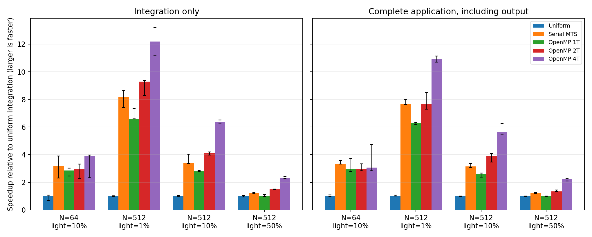

# Speed comparison

All implementations use identical initial conditions within each case,
the same macro step and physical duration, and a `releaseO3` build.
Each configuration has one warmup and 3 timed repetitions.
Runs are sequential in randomized order. Reported times are medians;
the CSV files retain the individual samples and timing ranges.

CPU: Intel(R) Core(TM) i7-10510U CPU @ 1.80GHz. Compiler: g++ (SUSE Linux) 7.5.0.
OpenMP uses fixed team sizes, core affinity and active waiting; full
settings are recorded in [results.json](results.json).

## Representative case

512 particles, 51 light particles, masses 1 and 100, macro step 0.01,
30 macro steps (physical duration 0.3):

| Implementation | Integration seconds | Integration speedup | Complete seconds | Complete speedup |
| --- | ---: | ---: | ---: | ---: |
| Uniform Verlet | 3.5119 | 1.00x | 3.5660 | 1.00x |
| Serial MTS | 1.0320 | 3.40x | 1.1330 | 3.15x |
| OpenMP MTS (1 threads) | 1.2571 | 2.79x | 1.3828 | 2.58x |
| OpenMP MTS (2 threads) | 0.8530 | 4.12x | 0.9086 | 3.92x |
| OpenMP MTS (4 threads) | 0.5512 | 6.37x | 0.6309 | 5.65x |

Integration timing excludes initialization, energy logging and snapshots.
Complete timing includes process startup and output with warm filesystem
caches. Worker startup is excluded only from the integration timer.

## Size and mixture dependence



MTS recalculates heavy–heavy forces once per macro step, rather than
at every small step. Its benefit grows when few particles are light.
OpenMP adds synchronization and atomic-update overhead, so small cases
can benefit less from parallelism. Candidate-pair counts for each case
are included in the JSON metadata.

The 64-particle case uses 200 macro steps; 512-particle cases use 30.
Compare implementations within a case; absolute times across cases
with different durations are not a size-scaling experiment.

These are fixed-step speedups, not matched-accuracy gains. See the
separate [energy comparison](../energy_order/README.md) and
[algorithm explanation](../../../docs/ALGORITHM.md) for the accuracy cost.
Timings are specific to this machine and workload. Plot error bars show
ranges over repetitions, not confidence intervals.

## Reproduce

From the repository root:

```bash
python3 validation/benchmark_speed.py --repeats 3
```

Use `--eigen-include /path/to/eigen`, `--omp-threads 1 2 4`, or
`--output-dir /path/to/report` as needed. Raw jobs are temporary.
Full data: [timing_summary.csv](timing_summary.csv),
[timing_samples.csv](timing_samples.csv), and [results.json](results.json).
